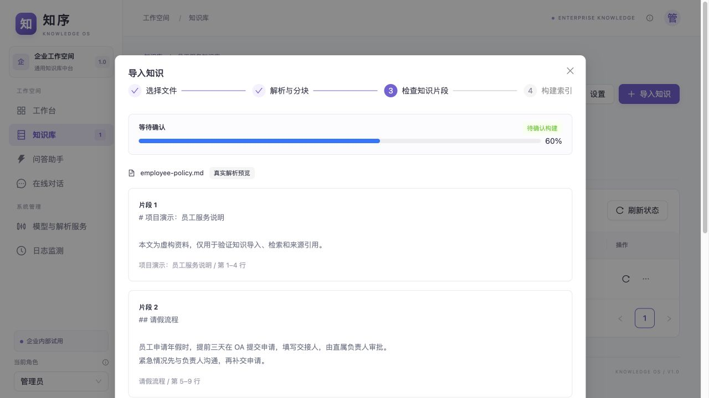

# 知序 · 企业知识中台

GitHub 仓库：[z2302743489/zhixu-knowledge-platform](https://github.com/z2302743489/zhixu-knowledge-platform)

面向企业内部试用的通用知识库项目：导入文件，检查解析片段，构建知识索引，再通过问答助手获取带来源的回答。前端使用 React + TypeScript + Ant Design，后端使用 FastAPI 与 LangChain。

> 本版不做登录，管理员、知识库管理人员、使用者可自由切换。角色用于操作体验，不能替代身份认证。适合本机验证及受控内网试用，部署边界见 [SECURITY.md](SECURITY.md)。

## 能做什么

- 知识库创建、分类、启停，文档上传、摘要去重、替换版本、分块预览、编辑与停用、原文件查看。
- 原生解析 Markdown、DOCX 段落/表格、XLSX/XLS/CSV；Word 内嵌图片、旧 DOC、PDF 图片/扫描页和图片调用阿里云 Document Mind 云端解析；不下载本地 OCR 或模型权重。
- LangChain Document + Splitter，云端 Embedding，Qdrant 持久化向量与中文稀疏索引，RRF 融合，以及独立 Rerank。
- 助手关联多个知识库；LangChain 历史问题改写、证据组装、SSE 流式回答、停止、历史和反馈；引用保存文档版本与片段快照。
- 独立配置 OpenRouter、AIHubMix、通义百炼的 LLM、Embedding、Rerank；服务地址、型号和 Key 均由管理员填写。
- 查询/导入/模型调用日志，真实耗时、服务商 usage、错误和 trace_id。没有返回 Tokens 时显示不可用；汇总按模型调用记录统计，避免和对话汇总重复相加。

这是可运行的代码交付。当前已通过的协议测试使用隔离的本地 HTTP 测试服务；三家服务商的真实账号、云端 OCR 及企业规模性能，仍需部署后用自有凭据和代表性文件验收。详见 [测试与验收](docs/TESTING.md)。

## 快速启动：Docker Compose

安装 Docker Engine / Docker Desktop 与 Compose 插件后，在项目根目录运行：

```sh
python3 scripts/generate_env.py
docker compose up --build -d
```

打开 **http://127.0.0.1:8080**。数据库、文件、Qdrant 和 Redis 都使用持久化卷；只有前端端口默认绑定本机。`generate_env.py` 只在 `.env` 不存在时创建随机部署密码与加密主密钥，不打印秘密。

```sh
docker compose logs -f api worker
# 结束运行，保留数据卷
docker compose down
```

内网迁移、备份与恢复见 [部署说明](docs/DEPLOYMENT.md)。当前开发机未安装 Docker；容器构建与服务间联通尚未在本机实测。仓库 CI 配置了前后端检查和镜像构建，推送后需确认其执行结果。

## 本地开发：Python 3.12 + Node.js 22

不依赖本地 PostgreSQL/Redis 服务即可开发。默认 SQLite 记录业务数据，Qdrant 本地磁盘存储向量，任务在同一进程后台执行；仍使用你配置的云端模型。

```sh
python3.12 -m venv .venv
# Windows 的解释器路径使用 .venv\Scripts\python.exe
.venv/bin/python -m pip install -r backend/requirements.txt
npm ci
python3 scripts/dev.py
```

打开终端显示的前端地址，默认 **http://127.0.0.1:5173**。脚本先执行数据库迁移，再启动 API（8010）与 Vite。Ctrl-C 同时结束两者。可用 `ZHIXU_API_PORT` 更换 API 端口。

也可以单独启动，便于调试：

```sh
.venv/bin/alembic -c backend/alembic.ini upgrade head
.venv/bin/python -m uvicorn app.main:app --app-dir backend --host 127.0.0.1 --port 8010
# 另一个终端
ZHIXU_API_URL=http://127.0.0.1:8010 npm run dev
```

API 文档：**http://127.0.0.1:8010/docs**。本地 `data/` 与 `.env` 已被 Git 和 Docker 忽略。

## 第一次使用

1. 管理员进入“模型与解析服务”，分别新增 Embedding、LLM，按需新增 Rerank。填写型号、服务商对应 API 根地址与密钥；Embedding 填写实际维度。执行各自连接测试。
2. 图片/扫描 PDF/旧 DOC 需要独立开通 Document Mind 并配置 AccessKey。当前适配地域为 `cn-hangzhou`，与百炼的 API Key 分开。
3. 创建知识库，绑定 Embedding 模型。导入 `examples/employee-policy.md` 或 `examples/benefits.csv`，先检查实际解析片段，再确认构建。
4. 新建助手，关联知识库、LLM 和检索重排设置并发布。
5. 进入对话提问“年假如何申请？”，打开引用，再到日志查看耗时与 usage。

未配置密钥时可上传原生格式并检查解析结果；构建索引、模型连接测试和问答会明确报告缺少配置。不会自动替换成假回答。

### 模型地址填写

| 服务商 | LLM / Embedding 根地址 | Rerank |
| --- | --- | --- |
| OpenRouter | 通常 `https://openrouter.ai/api/v1` | 对应根地址后调用 `/rerank` |
| AIHubMix | 通常 `https://aihubmix.com/v1` | 对应根地址后调用 `/rerank` |
| 通义百炼 | 账号地区对应的 `…/compatible-mode/v1` | 原生协议使用 `…/api/v1` 或完整的 `…/services/rerank/text-rerank/text-rerank` |

具体可用模型、地区、维度、批次限制和额度以你的服务账号为准。适配协议依据：[OpenRouter Rerank](https://openrouter.ai/docs/api/api-reference/rerank/create-rerank)、[AIHubMix Embedding](https://docs.aihubmix.com/cn/api/EBD)、[AIHubMix Rerank](https://docs.aihubmix.com/cn/api/Rerank)、[百炼 Embedding](https://help.aliyun.com/zh/model-studio/embedding)、[百炼 Rerank](https://help.aliyun.com/zh/model-studio/text-rerank-api)、[Document Mind](https://help.aliyun.com/zh/document-mind/developer-reference/document-parsing-large-model-version)。



## 工程结构

```text
src/                  React 页面、API 客户端、流式事件处理
backend/app/          API、业务数据、解析、任务、检索、模型适配与对话
backend/migrations/   Alembic 初始迁移
backend/tests/        业务、提供商协议、索引一致性与端到端测试
examples/             虚构演示资料，不包含企业数据
docs/                 架构、部署、测试与项目介绍
.github/workflows/    前后端检查与镜像构建
compose.yaml          单机部署服务编排
```

## 验证

```sh
npm run build
cd backend
../.venv/bin/python -m pytest -q
../.venv/bin/alembic upgrade head
../.venv/bin/alembic check
```

端到端用例临时监听回环端口，用测试凭据校验真实 HTTP 请求结构、向量写入、Rerank 和 LangChain 流式调用。测试服务只存在于测试目录，不会成为产品中的模型选项。

## 当前边界

- 目标是单企业、单服务器、≤1 万文件与≤20 路并发的内部试用；这两项尚未压测，不作为性能承诺。
- 本地 SQLite + 本地 Qdrant 只允许一个 API 进程。Docker 方案使用 PostgreSQL + 远端 Qdrant + Celery/Redis；生产集群、高可用与部门权限不在本版范围。
- 分块长度使用字符计数；表格按行分组、重复表头。复杂跨页表格与图示理解仍需实际文件评测。Excel 不执行宏，也不重算公式；无缓存的公式值提示不可用。
- Markdown 中的图片资源需单独导入，检测到未处理的图片引用时明确报错。当前未实现图片语义向量检索或跨表 BI。
- 中文稀疏检索使用 jieba、BM25 风格词频权重与 Qdrant IDF；融合分数是排序分数，不是答案可信度概率。
- 引用格式约束和可追溯性不保证答案事实正确；需使用独立问题集评估召回与回答质量。
- 首屏与会话返回有数量上限，列表接口提供分页；完整企业规模的浏览、日志保留策略和性能仍需进一步验收。

## 发布到 GitHub

源码中已提供 `.gitignore`、固定依赖、MIT 许可、示例资料和 CI。运行数据和密钥不包含在交付包里。上传整个项目源码目录，按 [发布说明](docs/GITHUB.md) 初始化仓库即可。GitHub 仓库默认设为私有；自动检查结果请以仓库 Actions 页面为准。

架构与可用于面试讲解的工程决策见 [项目架构](docs/ARCHITECTURE.md) 和 [项目介绍](docs/PROJECT.md)。
