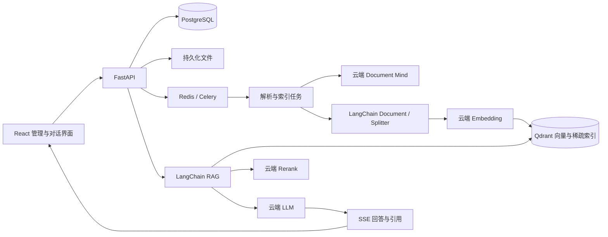

# 架构与数据流

## 业务数据

SQLAlchemy 表分别保存模型配置、知识库、文档、知识片段、导入任务、助手、匿名会话、消息、调用日志与系统设置。模型配置与知识库/助手存在外键约束；片段带文档与版本标识。API 返回 DTO，服务凭据只保留 hasKey 标志。

## 导入链路

1. 校验扩展名、文件魔数、大小与 Office 解压规模，计算 SHA-256。知识库内相同内容命中已有记录。
2. 原文件使用生成的文件名存入持久化目录；数据库记录 queued 任务。
3. 原生 Loader 或云端解析输出带位置的 LangChain Document；按标题、段落、表格边界切分。
4. 先预览并编辑片段，再确认构建；也可使用 autoBuild 自动执行。
5. 调用独立 Embedding，检查向量条数、索引、有限数值及维度，批次写入 Qdrant。
6. 新版本全部成功后原子切换 active_version；已发布原文件路径登记到版本清单。
7. 失败保留旧版本；旧索引清理延迟由 SQL 校验兜底并后台重试。

Embedding 指纹包含服务商、地址、型号与维度，配置身份变化不能与旧向量混用。当前禁止覆盖已有文档绑定的向量模型身份；需要创建新配置和知识库重新导入。

## 检索与问答

每个知识库根据其 Embedding 配置独立编码查询。中文 jieba 分词进入稀疏索引；向量与稀疏召回用 RRF 合并，各库相似度不直接相加。根据当前 SQL 活动版本与启用状态过滤后，按配置调用独立 Rerank。

LangChain 将会话历史改写为独立检索问题，组装有预算限制的证据与提示词，流式调用 LLM。资料内容视为证据，不执行其中的指令。服务端保留检索来源快照并校验引用编号，回答与真实引用持久化。会话使用浏览器匿名 Cookie 归属检查；角色切换不改变会话所有者。

## 日志和失败处理

对话、模型调用、导入分别记录状态；trace_id 关联一次问答的阶段。usage 由服务商返回，未知值是 null。对话总量与子调用属于汇总/明细关系，汇总时仅计算唯一的模型调用记录。

已有证据不等于回答正确；应独立评测事实、表格数值、资料外问题、冲突版本和多轮指代。当前没有未经测量的准确率或并发容量承诺。

## 选型原因

- React + Ant Design：表格、上传、抽屉和表单成熟，适合知识维护类后台；代价是初始包偏大。
- FastAPI + LangChain：Python 文档生态与模型链路组合方便；异步文件任务另交 worker，避免占住对话请求。
- PostgreSQL + Qdrant：事务数据和可配置向量检索分别管理；代价是跨库一致性与备份需要额外设计。
- Celery + Redis：长任务、重试和队列隔离；以数据库状态和恢复扫描补偿任务分发失败。
- 本机持久化卷：单服务器部署直接；多机扩展需替换成对象存储与共享文件抽象。

本地开发以 SQLite / Qdrant 本地文件降低安装成本，Compose 才启用已确认的生产技术组合。
