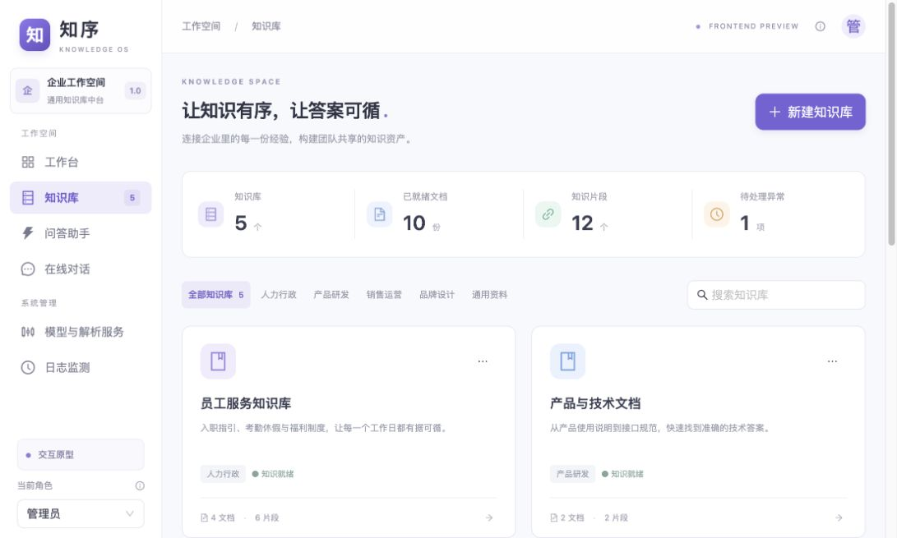
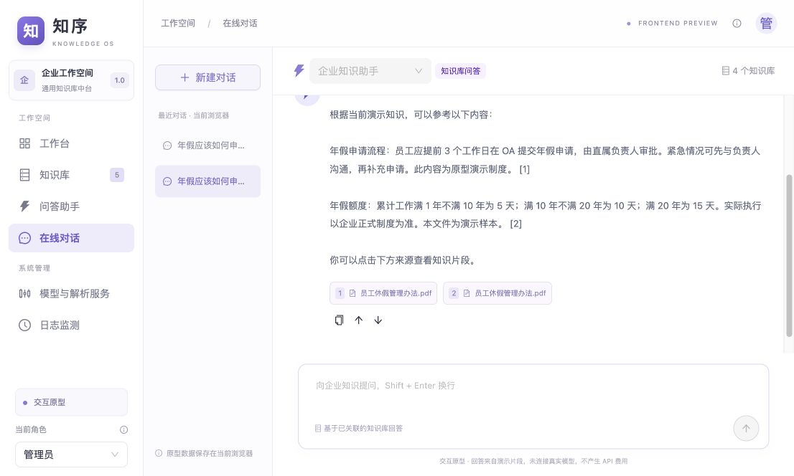

# 知序前端交互原型 · 历史自测记录

日期：2026-10-26。以下为当时的前端原型历史记录。

2026-11-07 已继续实现真实后端与前后端联调，当前状态请见 [docs/TESTING.md](docs/TESTING.md) 与 README.md；下文的“尚未开发”等描述仅适用于历史阶段。

## 已验证

| 模块 | 实际操作 | 结果 |
| --- | --- | --- |
| 构建 | 执行 `npm run build`，包括 TypeScript 检查与 Vite 生产构建 | 通过 |
| 本地服务 | 启动 Vite，访问 `http://127.0.0.1:5173/`，HTTP 200 | 通过 |
| 页面布局 | 浏览器截图检查知识库、导入、对话与来源侧栏；调整笔记本窗口高度下的角色入口 | 通过本次桌面窗口检查 |
| 知识库 | 新建“面试项目资料”，查看空状态，刷新后再次查看 | 创建成功，刷新后保留 |
| 导入向导 | 使用演示文件，经过解析与分块、固定样例预览、模拟构建、返回文档 | 完成；文档与片段计数增加，状态为已就绪 |
| 知识片段 | 编辑导入后的示例片段，停用并重新启用 | 内容更新；启用片段数从 1 变为 0，再恢复为 1 |
| 检索测试 | 在员工服务知识库检索“年假” | 本地关键词匹配返回 2 条演示片段；不是向量或 Rerank 实测 |
| 问答助手 | 打开企业知识助手配置，检查知识范围、模型、提示词、开场白、发布开关，保存 | 保存成功 |
| 在线对话 | 发送“年假应该如何申请？”，查看流式演示回答并点击引用 | 回答完成；来源侧栏展示文档名、位置和引用片段 |
| 对话取消 | 在生成中点击停止 | 回答标记已停止；日志记录“已取消”及本地耗时 |
| 历史会话 | 刷新后打开先前完成的对话 | 原回答与引用仍可查看 |
| 角色切换 | 管理员 → 使用者 → 知识库管理人员 → 管理员 | 使用者仅见对话；知识库管理人员不见模型与日志；管理员恢复全部导航 |
| 模型表单 | 空表单保存、填写演示名称/模型 ID/URL、模拟连接检查、保存 | 必填项提示生效；有效配置保存；未调用任何模型 API |
| OCR 表单 | 填写演示地域并保存 | 显示“已设置 · 未真实连接”；凭据输入清空 |
| 日志 | 查看导入、完成对话与取消对话记录 | 包含问题/任务、状态、耗时；新对话 Tokens 显示不可用，预置值标为样例 |
| 修复后控制台 | 检查最后一轮操作的浏览器错误日志 | 本轮未发现新错误或弃用提示 |

## 发现并修复

- 小高度窗口的侧栏内容过长：压缩间距并提供滚动，确保角色选择可访问。
- 表单验证失败产生未处理 Promise：校验失败保留表单提示并终止保存。
- Ant Design 新版属性弃用提示：更新 Tag、Alert、Drawer、Modal 属性，消息使用应用上下文。
- 表单实例挂载及重复字段 ID：预挂载表单，并使用独立表单命名空间。
- 开发热更新中旧标签页可能覆盖新数据：避免未修改数据重复写入，并监听跨标签页存储更新。修复后再次创建、刷新、修改片段与热更新，资料仍保留。本地存储仍不提供多人并发事务能力。
- 调整空库/无可用片段的状态文案，异常数量按实际文档计算。

## 验证边界

- 未验证任何真实文件解析、云端 OCR、Embedding、Rerank、LLM、向量数据库、API 密钥或真实 Token 计量。当前导入只记录文件名和大小，内容使用示例。
- Dockerfile 与 compose.yaml 已提供。当前命令环境未找到 Docker，未执行镜像构建或容器验收。
- 本次为桌面浏览器交互自测，未做完整移动端/多浏览器矩阵、无障碍审计或容量压测；1 万文件及 20 人同时对话仍是后端设计目标。
- 文件格式/大小限制、日志导出、全部删除确认、每种失败重试及所有组合参数未逐一进行浏览器回归；不得视作完整测试覆盖。
- 生产构建有约 1.21 MB 主 JS 包的体积提示，gzip 约 388 KB；构建成功。原型验收后可在正式工程拆分页面模块和依赖。
- 自测创建的“面试项目资料”、演示导入、模型配置及会话保留在本机浏览器中，方便复查。不同浏览器配置文件的数据不共享。

## 用户验收顺序

1. 检查左侧导航、知识库卡片、文档表格及左下角三种角色。
2. 进入员工服务知识库，用“使用演示文件”完成四步导入。
3. 打开知识片段，检查编辑、停用、来源位置和检索测试。
4. 配置问答助手，确认知识库范围、模型、提示词与发布方式。
5. 在线提问并打开来源，查看日志字段是否满足日常管理。

请确认以上页面和流程，或指出需要调整的部分。按已约定顺序，用户确认原型后才进入后端开发与真实模型联调。

## 截图

